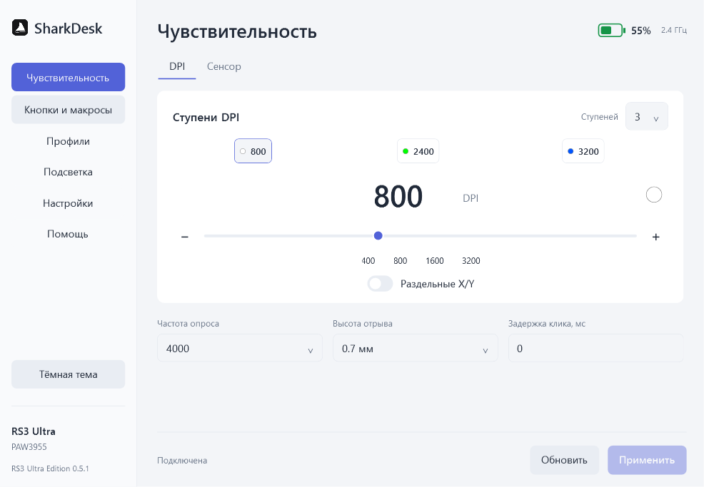
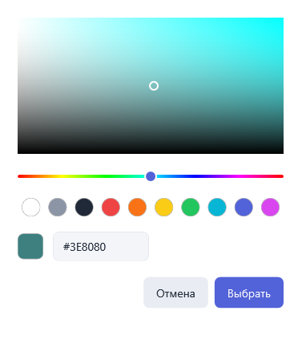

# SharkDesk RS3 Ultra Edition 0.5.1

Локальная адаптация SharkDesk 0.4.1 для ATTACK SHARK RS3 Ultra
(CID 124, MID 14, PAW3955). Исходный EXE в Downloads не изменяется.

[Скачать EXE](https://github.com/TISHKEREFPEK/sharkdesk-rs3-ultra/releases/download/v0.5.1-rs3/SharkDesk-RS3-Ultra.exe)
· [Страница выпуска](https://github.com/TISHKEREFPEK/sharkdesk-rs3-ultra/releases/tag/v0.5.1-rs3)

Предварительный выпуск: интерфейс и форматы протокола проверены, аппаратная
запись новых функций на мышь пока не проверена.





Запуск: `dist/release/SharkDesk-RS3-Ultra.exe`. Установка .NET отдельно не нужна.
Закрой другие экземпляры SharkDesk и официальный HUB перед запуском.

Основной экран: выбери ступень, введи DPI или используй ползунок и быстрые
значения. «Раздельные X/Y» открывает настройку второй оси. Круг справа от числа
открывает пикер цвета. Изменения записываются кнопкой «Применить».

Поддерживаются настройки сенсора, до шести ступеней DPI, цвета, подсветка,
назначения пяти кнопок, комбинации, мультимедиа и аппаратные макросы до
70 событий. Прошивка, сопряжение и сброс открывают установленный официальный
HUB. Это не официальный продукт ATTACK SHARK; собственного сервера обновлений нет.

Профили, тема, язык и резервные копии:
`%LOCALAPPDATA%/SharkDesk-RS3-Ultra/`.

## Сборка и проверка

Нужен .NET SDK 10 для Windows.

```powershell
dotnet build SharkDesk.csproj -c Release
dotnet run --project tests/Audit.csproj -c Release
dotnet run --project tests/UiAudit.csproj -c Release -p:UseAppHost=false
dotnet run --project tests/Audit.csproj -c Release -- --hardware-read
```

Проверка UI создаёт локальные PNG в `dist/qa`, использует тестовые значения и
не записывает настройки мыши. Аппаратные операции не запускаются обычными тестами.

Схемы команд сверены с официальным веб-драйвером
`https://controlhub.top/AttackShark/`, с конфигурацией RS3 Ultra и исходным EXE.
Первоначальные MIT-уведомления сохранены в `SharkDesk.THIRD-PARTY-NOTICES.txt`.
Рекомендации по анимации находятся в `ANIMATION-OPPORTUNITIES.md`; они не внедрены.
